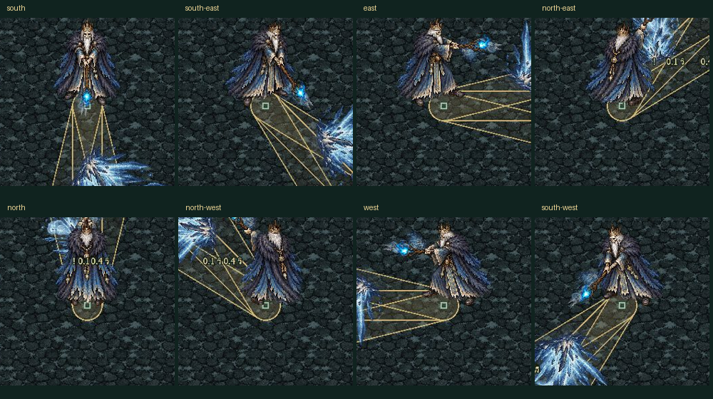
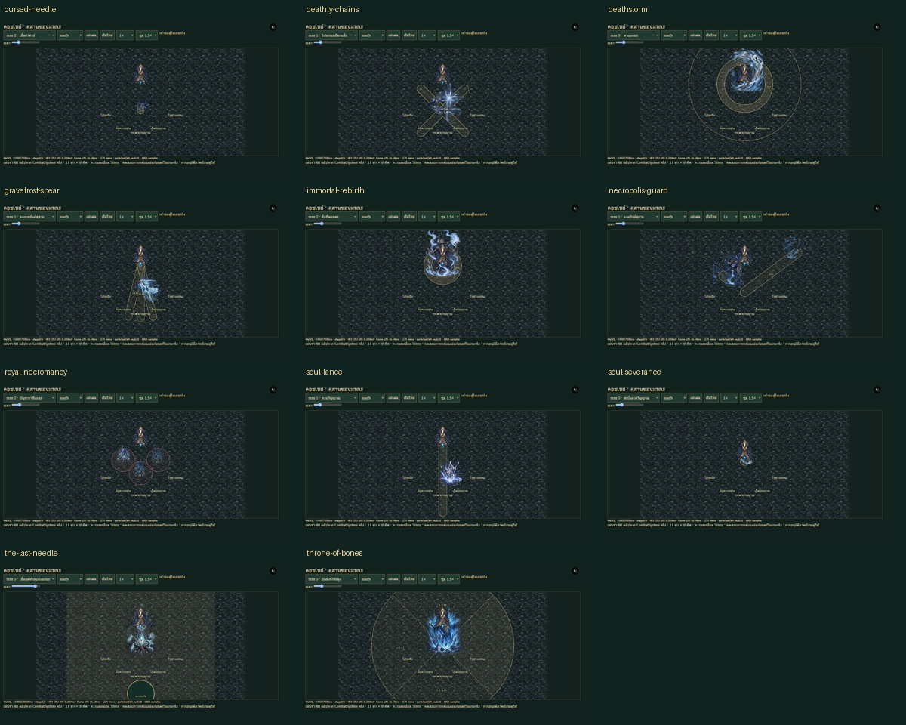
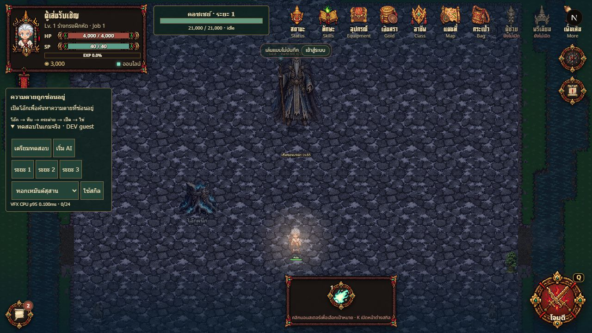

# Koschei — Russian Boss5 review delivery

Only Boss5 from the supplied Word is implemented. [Selected source](source.md),
[VFX contract and corrections](vfx.md), [arena layout](../../maps/frozen-necropolis/layout.md).
All stats, choreography, object locations and detailed counters are provisional
original game adaptation; not claims of canonical folkloric powers or approved
geography. Shuten/Maiyarap and existing travel systems remain unchanged.

## Launch and review

Run normal client/server development services (`pnpm dev` from repository root).

- Recorded server-clip lab: http://localhost:3000/boss-vfx/koschei
- Actual GameRoom: http://localhost:3000/?map=frozen-necropolis&koscheiReview=1
- Choose an unsaved guest, expand the Thai DEV controls, prepare, then use normal
  AI or an individual phase/skill. QA preparation gives4000HP and places the guest
  in the court. It is not ordinary progression, invulnerability or a saved account.
- Walk to the visible object and press E or the nearby interaction button. Open
  oak → chest → hare → duck → egg; only the released object can be interacted with.
  Attack the revealed needle normally with Q/selected target. Destroying it ends
  immortality and interrupts the ultimate. Opening a layer interrupts Rebirth.
- Boss remains at1HP until the needle is broken. Phase3 exposed needle gives a
  high-risk25% boss damage bonus; breaking it opens a4.5s stagger punish window.
- The Last Needle has premonition, mythic escalation, safe-path challenge,
  interactive container/needle counter and final burst. Failure still has a gold
  safe refuge at24,35. It is never a compulsory cinematic or mandatory party puzzle.
- This is an actual authoritative review arena, not a fabricated atlas portal.
  World travel adoption is separate; existing maps/portals are preserved.

## All abilities

|Phase|Ability|Distinct choreography / counter|
|---|---|---|
|1|Gravefrost Spear|Three staggered fan lanes; move between spear paths|
|1|Deathly Chains|Two crossed locked lanes; leave the intersection|
|1|Necropolis Guard|Two spectral guard charges from independent flank sources|
|1|Soul Lance|Long narrow staff ray, clipped without bending its aim|
|2|Immortal Rebirth|Bounded healing channel and ring; open next relic to interrupt|
|2|Cursed Needle|Three newly aimed thin needles, each with its own tell|
|2|Royal Necromancy|Three delayed tomb eruptions with walkable gaps|
|3|Deathstorm|Three expanding concentric bands with a reachable inner refuge|
|3|Throne of Bones|Four numbered, staggered sector judgments|
|3|Soul Severance|Three fresh-aim body rushes; passed ground is safe|
|3|The Last Needle|Five-stage ultimate; open nested relics, destroy needle or use refuge|

Independent server FSM owns idle/reposition/windup/active/recovery/stagger/
transition/ultimate/defeat, cooldowns, phase floors, damage and relic validation.
Phaser reads shared geometry/timestamps, pools organic art and keeps exact
ground tells below actors. React receives summaries and sends intents only.
No dream realm or existing boss behavior was copied into the signature system.

## Verification — 2026-10-16

|Check|Result / evidence|
|---|---|
|Authoritative behavior|876 checks;88 actual CombatSystem recordings; evidence/behavior.json|
|All10 skills, stand inside and walk dodge|20 actual GameRoom cases pass; every dodge0damage and remains in court; network.json|
|Solo ultimate|Real movement, proximity interaction and ordinary basic attacks; counter~14.3s, needle0HP, before32s final tell; network.json|
|Normal AI|11s per phase sampled with arranged HP/phases; all guests alive; network.json|
|Eight online lance directions|80damage each after unbent ray fix; network-extended.json|
|Failed ultimate / walk to refuge|190 /0damage; network-extended.json|
|Late join and isolation|Current relic stage synchronized; second-client review rejected; network-extended.json|
|Production|QA prepare/phase rejected, remote relic rejected; production.json|
|Art integrity/ports|248 alpha/dimension/hash and directional staff-port checks; art.json|
|Build/typecheck|pnpm typecheck and bounded-worker full build pass,40routes|
|Regression|Shared suite, Maiyarap620 and Shuten179 behavior checks pass; no other boss edits|

The main network suite uses port2606, production2607. It never teleports a player
after casting or gives hidden invulnerability to prove a dodge. Damage receipts
have ±125ms uncertainty (30Hz simulation,50ms patch,75ms observation).88 lab
clips sample50ms; this is not88 independently played online fights or zero-lag
visual synchronization. QA phases/4000HP are not a continuous balanced victory.

Reproduce after building shared/schema/server:

```text
node tools/bosses/koschei/behavior-test.mjs
node tools/bosses/koschei/network-test.mjs
node tools/bosses/koschei/network-test.mjs --extended
node tools/bosses/koschei/production-test.mjs
python tools/bosses/koschei/art-test.py
```

Python asset tools require Pillow. `pack_art.py` retains source RGBA pixels and
measured cuts; `audio.py` reproduces the three original synthesized cue WAVs.

## Artwork, performance and honest limits

19 ImageGen source PNGs with prompts and generation receipts are retained under
`apps/client/public/assets/boss/koschei/source`;2 rejected directional candidates
are explicitly excluded.45 total PNGs include originals/runtime cuts.11 distinct
8-frame organic flipbooks, crypt/tombs/frost floor/mist and6 relic props are used.
No core missing-art placeholder remains. No third-party sprites or copied sacred
script used. The shared art-direction constraints still apply.

Eight directions have3 unique authored body poses across4 timing beats: idle,
raised-staff windup, release, reused idle recovery. Locomotion is deliberate
gliding, not an authored walk cycle. Eight death-collapse frames share one
south-east view, not8 unique directional deaths. Transitions reuse authored
Rebirth/oak material; no bespoke cinematic movie. Three synthesized cold-bell
cues are not recorded Russian instruments, voice acting or a music score.
Additional in-between/locomotion/directional-death/audio polish remains possible;
60Hz rendering never means60 authored frames or final user art approval.

24 critical views with max4 scheduled hazards,64 cosmetic particles,233 pooled
GameObjects. Important overflow errors, cosmetic overflow may drop; all owned
objects/textures/listeners/masks clean up. CPU/RAF observations with exact viewport
are saved in performance.txt/png. They do not measure GPU or physical phones.
Final WebGL1280×720, rolling1800 RAF samples, frozen Throne at1860ms with4views:
VFX CPU p95=.200ms, frame interval p95=16.68ms; cosmetic peak18/64 retained from
prior playback, current0. This is a repeated renderer workload at a fixed timeline
point, not a sustained AI-fight benchmark or a whole-game60FPS guarantee.
Desktop1280×720, emulated390×844 and844×390 inspected; same session survives
orientation. Landscape camera/badge correction keeps the crown and player out
of HUD overlap; zoom still clamps to the map cover floor. Canvas/reduced-motion
fallback exists, but physical-device/Canvas visual certification is unverified.
High latency, full production load, final balance and user artistic acceptance
remain unverified. Stop this boss batch for review.




