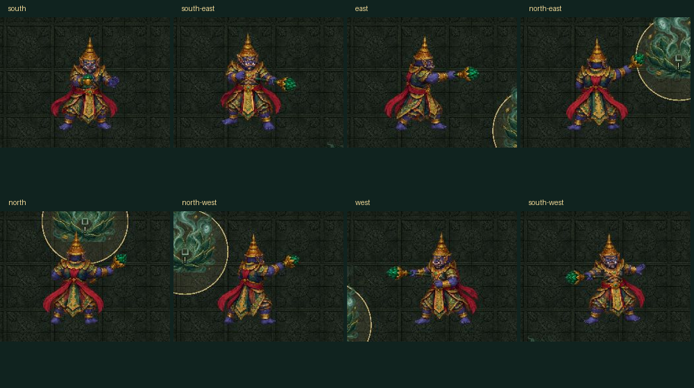
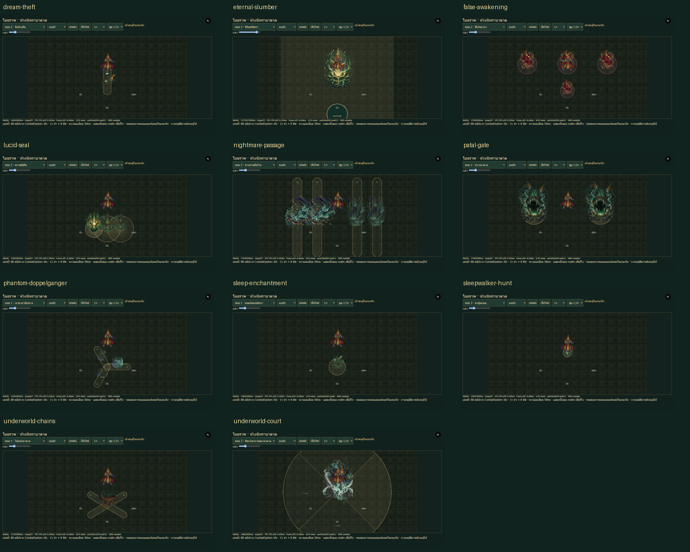
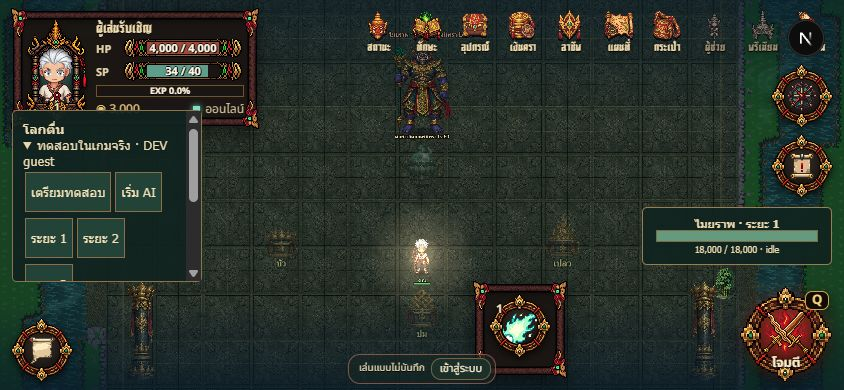

# Maiyarap — Boss13 review delivery

Implemented only Boss13 from the supplied Word. [Selected source](source.md),
[VFX contract](vfx.md), [arena layout](../../maps/maiyarap-palace/layout.md).
All numerical balance, geography and detailed puzzle rules are provisional
original game adaptation. Other bosses and existing portals are unchanged.

## Review

- Recorded server-clip preview: http://localhost:3000/boss-vfx/maiyarap
- Actual GameRoom: http://localhost:3000/?map=maiyarap-palace&maiyarapReview=1
- Start the normal client and server. Choose an unsaved guest, expand the Thai
  DEV panel and prepare. It grants4000HP and places the guest in the court;
  phase/skill buttons are explicitly QA arrangements, not ordinary progression.
- Normal controls: movement, Q/basic attack, E at a nearby gold symbol. Dream
  order is lotus → knot → flame, then destroy the exposed source. This wakes
  players and staggers Maiyarap. Phase3 additionally offers intentional lucid
  entry and a vulnerable boss while dreaming. Movement is never sleep-locked.
- Production rejects review commands. The review arena has no fabricated atlas
  portal; adopting a world travel route is separate from this boss review.

## Functional coverage

Phase1: Sleep Enchantment, Underworld Chains, Phantom Doppelganger, Patal Gate.
Phase2: Dream Theft, False Awakening, Nightmare Passage.
Phase3: Lucid Seal, Underworld Court, Sleepwalker Hunt.
Eternal Slumber has premonition, split, passage challenge, symbol/source counter
and finale. Destroying its source cancels damage; failing still leaves the gold
southern safe pocket. The solo source counter finishes around17.7s before the
22s final warning. Threshold floors at70%/35% prevent skipped transitions.

Server FSM owns cooldowns, cast/active/recovery, repositioning, real damage,
realm filters, interruption, source death, wipe/leave/respawn and cleanup.
Phaser uses the same geometry and timestamped hazard state. Organic effects
use11 authored PNG flipbooks with ground, gathering, primary, trail, contact,
secondary and decay layers. Hit indicators remain Graphics for exact readability.

## Evidence and verification — 2026-10-16

|Check|Result and evidence|
|---|---|
|Authoritative behavior|620 checks,88 actual CombatSystem recordings; evidence/behavior.json|
|Each of10 skills, positive and actual walking dodge|20 actual-room cases; every dodge0damage; evidence/network.json|
|Normal AI|All3 phases sampled11s each using arranged phases/HP; network.json|
|Solo ultimate|Real walk, symbol proximity and normal attacks destroy160HP source; network.json|
|Eight actual room facings|Sleep hit55 in each facing; network-extended.json|
|Ultimate failure and safe pocket|Outside180damage, actual walk to pocket0damage; network-extended.json|
|Lucid damage, late join, review isolation|Pass; network-extended.json and production.json|
|Source integrity and atlas alpha/frames|226 checks; art.json. Pixel uniqueness is not chronology approval.|
|TypeScript and full build|pnpm typecheck; SHAMAN_BUILD_WORKERS=2 pnpm build pass,39 routes|
|Existing boss regressions|Shuten179checks, VFX140749checks, complete-behavior-test pass; no Shuten edits|

Reproduce from repository root:

```text
node tools/bosses/maiyarap/behavior-test.mjs
node tools/bosses/maiyarap/network-test.mjs
node tools/bosses/maiyarap/network-test.mjs --extended
node tools/bosses/maiyarap/production-test.mjs
python tools/bosses/maiyarap/art-test.py
```

Build shared/schema/server first for the room tests. They use isolated ports2603
and2605. Network receipts have ±125ms observation uncertainty, not frame-perfect
network proof. The visual lab replays50ms recordings; it does not award damage.
All88 clips and eight actor directions were inspected in the lab. This does not
claim88 separately played online fights or a continuous balanced victory.

## Visual corrections and performance

Fixed source cast packing: equal row cuts clipped crowns and included neighboring
crowns.32 measured body components now retain the authored staff and ornaments
without neighboring poses. Original source PNGs remain intact. North facade width
was corrected individually after its roof exceeded the world. Camera lookahead
and HUD positions keep boss/player visible. A court mask prevents warnings from
painting the safe arrival, and main organic layers remain beneath actors.

Final desktop1280×720, emulated portrait390×844 and landscape844×390 screenshots
are game-desktop.png/game-portrait.png/game-landscape.png. Resize retains the
same room and player position. Facing and11 skill screenshots are recorded lab
evidence; game screenshots are actual online GameRoom evidence.

Final WebGL ultimate replay,1280×720, rolling1800frame sample: frame interval
p95=16.68ms; VFX adapter CPU p95=0.100ms, cosmetic peak24/64. Pool24 critical views
with tested peak4,233 preallocated GameObjects. See performance.txt/png. These
are browser CPU/RAF measurements, not GPU timing, physical phone results or a
whole-game60FPS guarantee. Canvas fallback and reduced-motion code paths exist;
this delivery does not claim physical-device or Canvas visual certification.

## Artwork and remaining polish

15 ImageGen sources and prompts/receipts remain in the repository;39PNG assets
include originals and runtime cuts. No external game artwork or procedural flame
stand-in is used. Actor has8 idle directions,4 cast poses per direction and8
death dissolve frames. Death is one shared south-east dissolve; royal movement
uses idle-based gliding, not an authored walk cycle. Phase presentation reuses
cast/aura materials, not unique cinematic animation. Three original synthesized
chimes are functional cues, not bespoke Thai instruments, voice or music.

Core mechanics and requested review presentation are implemented. Additional
locomotion, directional deaths, cinematic transitions, voice/music and final
balance/art approval remain explicitly outside the verified finish claim.
No user artistic approval or end-to-end normal-character victory is claimed.




