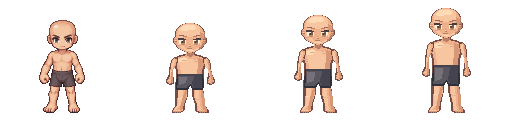

# BaseCharacterV3 - First FRONT Prototype

2026-10-10. Latest USER requests an independent compact original Shaman body,
not continued V2 retouching. Three original manually authored static FRONT PNGs
are published for review at `/characters/v3`; V2 remains unchanged except an
additive inspector navigation link. No gameplay renderer, registry or server change.

## Review

- [Exact4x comparison](comparison-4x.png): 2048x512, order V2/A/B/C.
- [A](A-4x.png), [B](B-4x.png), [C](C-4x.png): each512x512.
- Source PNGs A/B/C are native128x128, transparent, guideless and unmodified.
- Common origin61,112 and actual lowest visible row112. V2 is not translated.
- Head30px high/34px wide, same newly authored head/face bytes in all variants.
- A90px/3.000; B98px/3.267 (rounded3.25 target); C105px/3.500.
- **Recommend A for the latest compactness brief, not approval or selection.**
  B is a less squat compromise; C retains the longer torso the USER disliked.
- Art remains a first prototype: torso shading is broad/flat; flank/forearm
  transitions and hands/feet are angular, and the bald head may read severe.
  No claim of professional-final Classic RO quality or USER acceptance.

The nine-color skin ramp uses broad upper-left highlights; four eye colors and
four charcoal shorts colors make17 visible colors. Opaque shorts are baked modest
base coverage, not an interchangeable outfit. No hair/accessories/weapons.

## Source And Rig

`art.json` retains integer head rows, per-variant body polygons/coordinates,
palette, head pixel hash and the complete original rasterizer's path/hash.
`tools/rig/character_v3_front.mjs` explicitly authors every face and small limb
cluster, with no source-art sampling. `publish_character_v3_front.mjs` emits
PNGs and direct-row/native4x diagnostics; no resizer, V2 copying into V3 bodies,
warping or body deformation. Only the V2 comparison itself is a byte-exact copy.
Owned concept and V2 hashes/use restrictions: `owned-references.json`.
No third-party sprite pixels, extraction, model input or training.

`pose-rig-template.json` supplies three static SOUTH poses, each21 provisional
visible-coordinate anchors. Screen-left/right is explicit, not anatomical left,
skeletal bones, deformation or fitted equipment. Future bindings require USER
body approval and then a body lock; all such gates are false now.

`proportion-comparison.md` distinguishes actual alpha measurements from manually
selected semantic envelopes. `measurements.json` includes actual per-row bounds,
region widths/occupancy and provisional landmarks; rectangles are NOT automatic
semantic segmentation. V2's historically approved asset stays approved in its
unchanged manifest; the V3 comparison's false flag does not revoke that approval.

## Cost And Validation

Live read-only schemas, capabilities and quote saved here before publication.
Native128 creation provisionally6/image, three independent images18; identical
face pixels are not guaranteed by separate jobs. Manual authoring deterministically
enforces identity, spends0, jobIdnull, paidCalls0. Prior V2cap20/spent20/remaining0;
no new V3 paid budget approved. No paid request/retry/pending generation.
`v2-frozen.json` snapshots192 existing V2 design/runtime files outside this directory.

Focused V3 tests, V2 publication regression, workspace typecheck/build and editor
diagnostics pass. Browser6 cases cover1280x900,390x844,844x390 at1x/4x:
24 canvas/source pixel comparisons mismatch0, nearest filtering, guide coordinates,
21 anchors/panel and no page overflow.4x keeps512px and scrolls locally on mobile.
`browser-checks.json` stores actual results. Four actual captures were inspected;
host reflow clipped lower panels and mispositioned the4x capture. They are NOT
art evidence or responsive/real-device visual sign-off. Source PNGs are primary.
Post-capture pointer follow-up was intercepted by host toolbar/fieldset reflow;
keyboard Space verified1x and both overlay toggles, source pixel changes0.
Actual host733x515, not requested1280x900: `browser-followup.json`. This is not
an additional successful desktop pointer or responsive-layout assertion.

Reproduce: `node tools/rig/character_v3_front.mjs --probe`, then
`node tools/rig/publish_character_v3_front.mjs`, then
`node --test tools/rig/character_v3_front.test.mjs`.
The read-only capability script is optional for repeat builds, not a generation
command. Browser receipts are recorded from actual tool results, never invented.

STOP for USER review of these three fronts. No directions, hair, outfit,
weapons, accessories, animation, body lock or live adoption are authorized here.