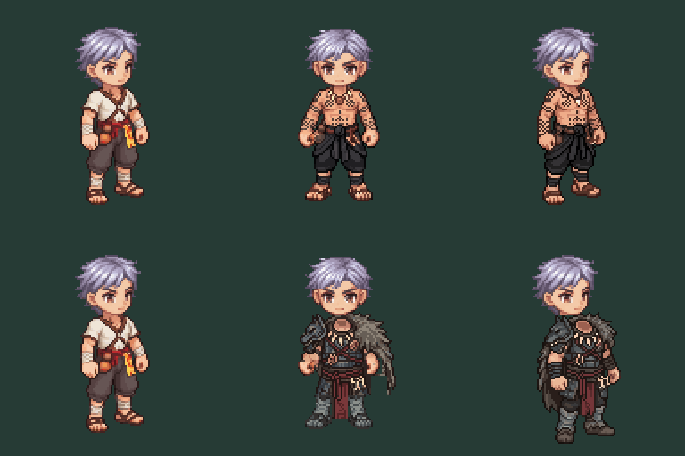

# Male first-pair SOUTH-EAST static proof

User requested the next stage after the SOUTH preflight. Two bounded PixelLab reference edits apply revision03 SOUTH costume identity to the actual unchanged SOUTH-EAST idle source. One attempt per class, no automatic retry. This is a directional art proof, not bulk production or approval of an appearance architecture.

Columns: original SOUTH-EAST novice; prior SOUTH costume; new SOUTH-EAST costume. Head art is unchanged and composed offline using the real manifest neck minus head pivot offset (-3,-1) for SOUTH-EAST. No head regeneration, weapon baking, runtime substitution or female work. Previous SOUTH outward-axe correction remains unchanged; this sheet intentionally shows costume geometry without gear.

## Inspection

Both raw outputs are128×128. Original source body/head hashes match their manifest. Achan lowest opaque row114 matches source; tattoos and black wrap carry into the diagonal. This does not certify full skin preservation, exact hand contacts, neckline or clipping.

Juggernaut lowest opaque row120 exceeds source114 by6px. Visual inspection also shows arm/hand placement drifting downward and changed boot geometry. **Reject this raw output for rig use**; retain it as directional costume reference only. Do not normalize it by whole-body scaling or move the gameplay hand anchors. A source-bound lower/arm repair is required before equipment review. No image has visual approval or runtime certification.

Run `node docs/design/equipment/class-2-diagonal-01/review.mjs` to reproduce hash/dimension/ground measurements and the offline comparison. Native PNGs and `checks.json` are the evidence; the preview is not live Phaser/SSR and does not test animation, protected anatomy, fingers-over-shaft or equipment layering. No build/gameplay checks were run because runtime code is unchanged.

## Cost / next stage

`jobs.json` retains exact prompts, seeds, source and submission receipts; `receipts.json` retains completed provider receipts. Charged10+10=20 generations, balance195→175. Retries0. SOUTH originals and public assets remain untouched.

Next: repair Russian ground/arm geometry against the exact SOUTH-EAST source; audit both candidates' contact and neck regions; then produce equipment overlay evidence using the actual directional renderer. Six other static directions and all outfit animation clips remain absent. Hurt/death clips remain unsupported by current V3. Full production layer/appearance policy remains a proposal.
