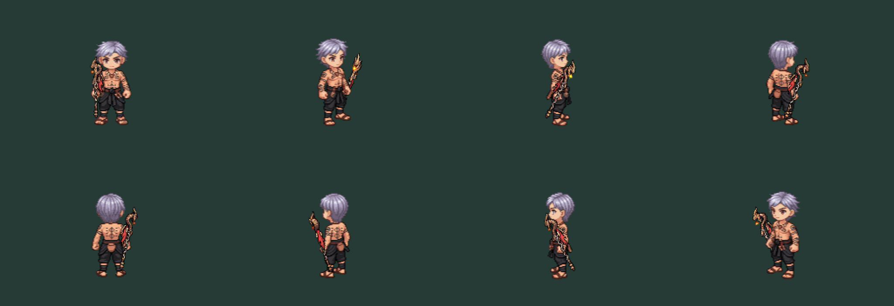
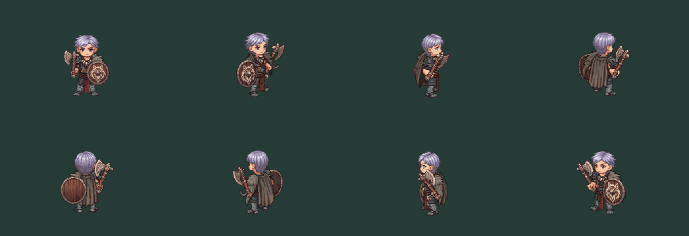
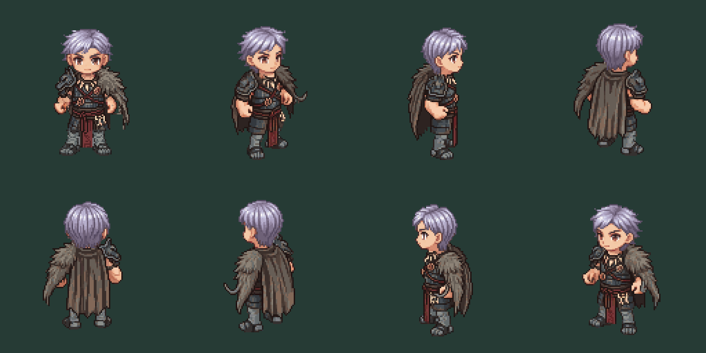
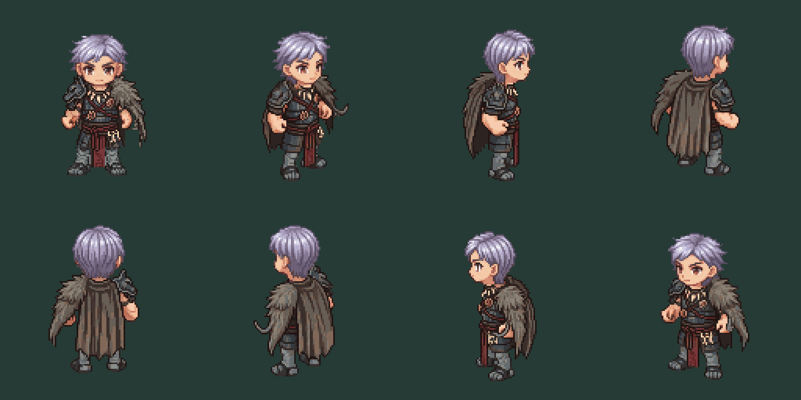
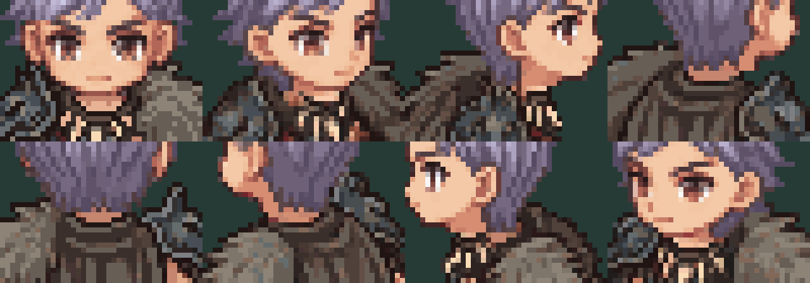
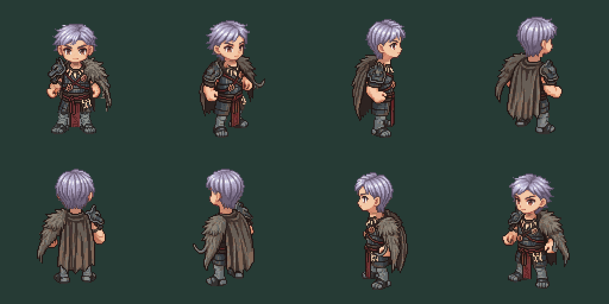
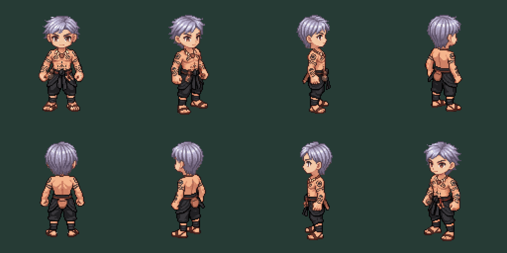
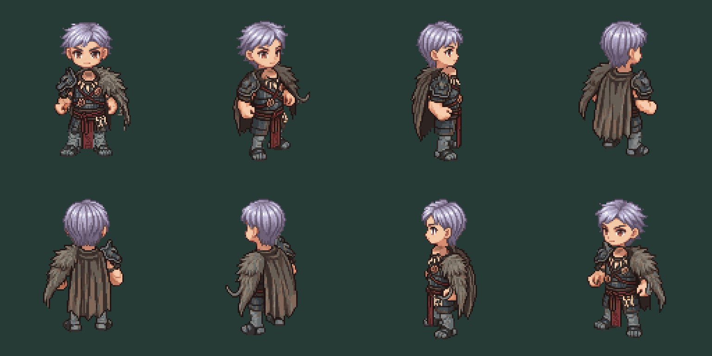

# Male first pair — V3 eight-direction rotation

## Latest joint equipment pass

[Paired static production checklist](PAIR_READINESS.md) records both countries together, actual renderer-source versus candidate gear placement, user Russian head offsets, three guarded Thai back tattoo repairs and open motion/runtime gates. Joint visual board: http://127.0.0.1:8767. Added paid generations0; no runtime/female changes.

## User-operated head editor

### User-saved placement review

Read actual user-head-offsets.json after user requested inspection. Rendered exact values without adjustment via HEAD_FIT_REVISION=user and fit-head.mjs. Eight unique named bounded integer offsets pass; unchanged original heads/costume hashes pass. Inspected complete eight-view sheet and8x neck crops. No obvious transparent break between head/neck/collar in the shown static composition; forward/back views retain a short skin band and side collars remain asymmetric. This is a visual observation, not an automated fit score, user approval, motion check or equipment certification. User values are the current review candidate; both earlier assistant fits remain rejected history.

[Neck detail8x](juggernaut-neckuser-8x.png). No additional credits or runtime/female changes.

User rejected both automatic fits and requested a website to adjust placement directly. Run `node docs/design/equipment/class-2-eight-01/head-editor.mjs`, open http://127.0.0.1:8766. Local-only standalone editor embeds existing original head/body PNGs; no game changes or paid generation. Eight directions, integer drag/numeric/arrow controls, pixel grid, thumbnail review, local draft storage and JSON export. Save writes only user-head-offsets.json in this directory, with origin checking and bounded named integer offsets. Browser-tested image load and1px right/reset controls. Actual user fit is still pending; don't label initial values approved. Saved offsets are head image offsets, not body neck target coordinates.

## Russian head placement correction

### Revision02 — latest candidate

User rejected the first fit because the neck still protruded. First fit is retained as rejected review history. `juggernaut-head-fit02.json` lowers the head2–3 native pixels and shifts the relevant side/diagonal views1px horizontally to seat the head into the collar. Reproduce with `HEAD_FIT_REVISION=02` when running fit-head.mjs. Inspected the entire eight-view sheet and eight8x collar crops; original head/body hashes pass. This is a second placement candidate, not user-approved art. No source pixel edits, rescaling, paid generations, runtime or female changes.

Before/after02 shows rejected first fit above and latest fit below. The unchanged head includes its own neck pixels; aligning just the body's visible skin center in revision01 left those pixels extended. Revision02 addresses the visible head-to-collar seam instead. Pose/hand/cape issues remain separate and open.

User requested fixing the Russian head first. `juggernaut-head-fit.json` records eight candidate-local static neck targets from generated collar skin clusters, followed by visual inspection. `fit-head.mjs` composes the unchanged directional heads at these offsets; it does not edit either raw head or costume PNG. Original source-body neck offsets caused the mismatch because generated collars moved. No global rig pivot, gameplay, female asset, Thai preview or paid generation changes. All eight body hashes match checks.json and heads match the production source manifest; command passed.

[Before/after sheet: before above, corrected below](juggernaut-head-before-after.png). Reproduce with `node docs/design/equipment/class-2-eight-01/fit-head.mjs`. Values are static preview attachment targets, not approved animation pivots or runtime integration. Visual acceptance remains user-owned; grip/cloth/action checks remain open.

User explicitly requests all eight directions in one job per class after rejecting the piecemeal diagonal workflow and Russian neck/head mismatch. Two V3 reference rotations were submitted from the revision03 SOUTH headless costume bodies; no text-created replacement base or female input. SOUTH source and existing public head/body/equipment assets remain untouched.

## Jobs and cost

| Class | Character ID | Quoted cost |
|---|---|---|
| Achan | 05e4e4fd-9203-499e-b242-1172d878a478 | 2 generations |
| Juggernaut | f91f67fa-0465-4146-b4fc-e266342a2790 | 2 generations |

Exact prompts/submission receipts are in submissions.json. One attempt each, no retry. Both jobs now completed: sixteen real128×128 PNGs downloaded under achan/ and juggernaut/. Observed balance175→171 confirms4 total generations. No animation or visual approval is claimed.

## Completed review

`review.mjs` ran successfully against all16 files: dimensions and original source body/head hashes pass. SOUTH returned pixels are not byte-exact to the submitted source for either class, so these files remain separate provider outputs; original SOUTH art is retained unchanged. Ground differences versus the source rig range -1 to+1px for Achan and -2 to+2px for Juggernaut. See checks.json for each direction.

Order: SOUTH, SE, E, NE / N, NW, W, SW. Native raw sheets are achan-raw-3x.png and juggernaut-raw-3x.png. Head diagnostic sheets use unchanged heads at source offsets; this is not a fitted-neck approval. Visual inspection finds Achan back tattoos missing over much of the back, and Russian side/diagonal arms and fists differ from original grip poses. Cloak width, collar/head junctions and asymmetric side identity need further review. These are complete directional costume proofs, not ready-to-swap body frames. No automatic extra paid repairs or runtime publication.

## Validation prepared

After downloading actual completed rotations into `<class>/<direction>.png`, run `node docs/design/equipment/class-2-eight-01/review.mjs`. It requires all eight named128×128 PNGs, verifies existing source body/head hashes, records raw opaque bounds and ground deltas, compares returned SOUTH pixels against the exact input, and makes raw plus source-anchor head diagnostic sheets. It does not fit the generated neck automatically or certify hand contacts. A source pivot is not a measurement of a newly generated neck. Inspect these before calling any composite production-ready.

Do not reuse the rejected diagonal Russian output or silently submit new generation jobs. Remaining live Phaser/SSR, equipment contacts, layered costume architecture and animation gates are open. Runtime code and female pipeline unchanged. No build/gameplay tests were needed for this offline asset/documentation retrieval.
