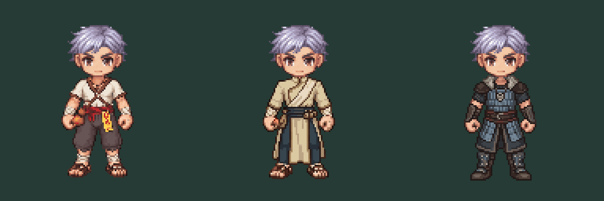

# Class 2 first-pair SOUTH concepts — 2026-10-12

User authorized image generation and credits after specification revision 2. Scope chosen: one SOUTH static attempt each for male Achan Saiyasat and Juggernaut Volkhv. No retries, rotations, animations, other classes or gameplay integration performed. Female pipeline untouched.

Left: unchanged Medium source. Center: Achan. Right: Juggernaut. Head is the same owned `head-eight-01/south.png`, mechanically placed at idle neck minus head pivot (0,−1). It was not regenerated. These are offline static review composites, not the SSR runtime screenshot or a new base model.

Source: `apps/client/public/assets/character-v3/body-eight-02/south.png`, SHA256 `c4c0ade151545e99ba6fa003d4f597142e004c6b8c214147a552df17ed5ab906`. Source and production assets are unchanged. Raw provider outputs retained as `achan-raw.png` and `juggernaut-raw.png`; full prompts/seeds/job IDs/receipts in generation.json and results.json. prepare-review.mjs reproduces head composites and nearest4x previews without a paid service.

Costs: capability quote suggested6 per128 edit, but submitted edit_image receipts estimated10 and completion confirmed10 each. Actual20 total; balance255→235. No re-rolls. Jobs: Achan e76263ef-577a-4a68-943a-0cd05328ab08; Juggernaut 8f170d27-cee3-48f7-9a8c-226bf627bfb1.

## Review disposition

- Both raw outputs are128×128 transparent PNGs. Achan retains the ivory/indigo vertical split-cloth concept; Juggernaut reads as blue-steel compact heavy armor with grey collar and dark leather.
- Existing head/face/hair and source body files are preserved. This does not mean AI output body pixels match source: checks.json reports15 and44 changed pixels respectively outside source body band y47…112. Changes include clothing/boot extent; this coarse diagnostic is not an anatomy validator or proof that pivots/grips stayed correct.
- Achan's amulet grouping/bronze ritual detail is understated; Juggernaut's collar reads more like grey edging than clear fur. Check these against the approved concept before expanding.
- Exposed-hand anatomy, cuffs, feet/contact row and outline continuity require detailed mask comparison before production. Do not infer identical hand pivots from the unchanged canvas.
- No staff/axe/shield is baked into these concepts. Actual weapon composition/clipping remains unverified; no weapon offsets were changed to fit the outfits.
- These are flattened clothed-body proposals, not extracted torso/sleeve/leg layers. Layer contract, body-armor override, V3 resolver and animation compatibility remain unimplemented/unapproved.
- Visual approval pending. No complete technical or production readiness claim. Next dependent gate is user review of first-pair costume direction; do not spend credits on eight directions or bulk animation automatically.

Code/build tests were not run because production/runtime code was not modified. The local review script checks dimensions/hashes and builds comparison images; full validation pipeline remains a proposal.
