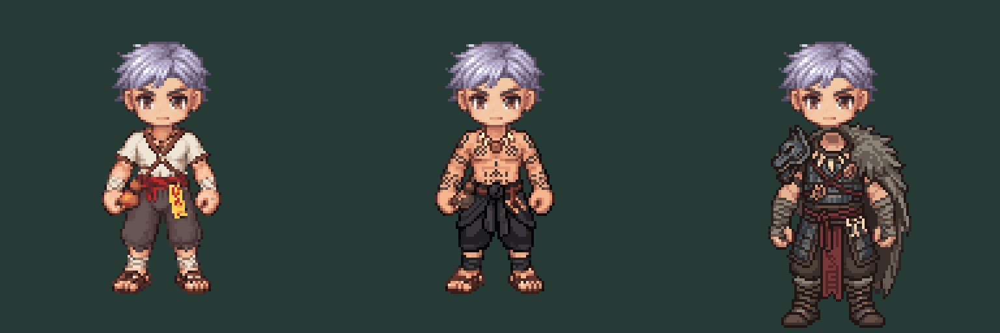

# First pair revision 02 — stronger occult identity

**Next-stage evidence:** [SOUTH rig/equipment audit](rig-audit/README.md) records existing weapon placement and required repairs. Russian lowest opaque row125 versus baseline112 blocks technical expansion; both hand regions need review. Approved costume direction remains intact. No credits spent for the audit.

**USER VISUAL APPROVAL — 2026-10-12:** “แบบนี้ชอบเลยผ่านครับ”. Both displayed SOUTH costume concepts (Thai Achan shirtless tattoo/black wrap and Russian Juggernaut fur/armor/amulets) are visually approved. Approval applies to these exact raw PNGs and their shown static head composites, not ungenerated directions, animation, grip/anchor accuracy, modular layers or runtime compatibility. Preserve these approved originals; any technical corrections require comparison against this baseline. No further generation or credits spent when recording this approval.

2026-10-12 user rejected ordinary-looking first pair and requested shirtless full-body tattoo Thai occult practitioner, and more powerful/frightening Russian shaman. This overrides the earlier ivory-shirt Achan direction. The uploaded photo is preserved as user-thai-mood-reference.png; viewed and described as mood only, not supplied to the generation service or used to copy the person's face or actual inscriptions.

Two SOUTH128×128 static edits, one attempt each,20 generations charged, balance235→215; no retries or further facings. generation.json records exact prompts/seeds/receipts. Existing male head is composited unchanged using the prior static review script; existing body/head source files and runtime are untouched. Female pipeline untouched.

Achan: shirtless chest/arms with dense invented dark geometric tattoo clusters and black wrapped waist cloth. Juggernaut: asymmetric fur, dark armor, bone/fang amulets and crimson ritual ties. These are concepts, not production-ready layers or approved visuals. Do not automatically expand animation.

Technical caveats: generated anatomy/grips/feet are not guaranteed identical despite the source-conditioned prompt. checks.json verifies128 canvas and source hashes only, plus a coarse outside-body-band diagnostic (Achan0, Juggernaut313 changed pixels outside y47…112); the latter includes expanded costume extent and requires source-mask/anchor review, not a pass/fail anatomy claim. Russian fur/shoulder extent must be checked against head, axe/shield and viewport readability. Tattoo readability at actual gameplay size still needs visual review. No weapons/VFX baked or integrated; no runtime/code tests appropriate to these offline art files.
