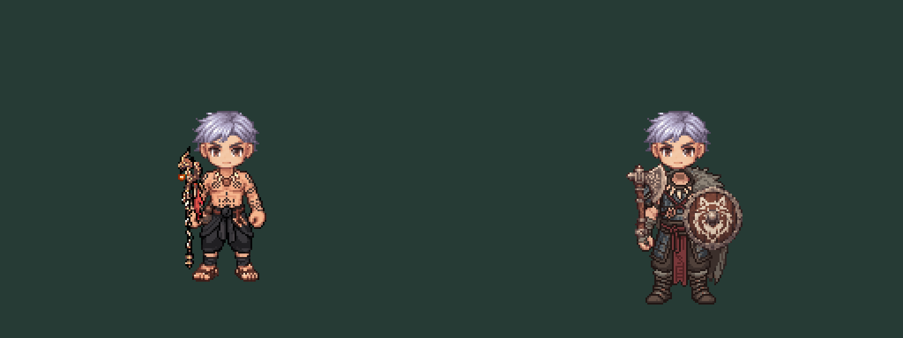

# SOUTH rig / equipment compatibility audit

2026-10-12. User approved revision02 costume visuals, then authorized next step. This step audits SOUTH static compatibility, without changing runtime, approved originals, pivots or female assets. Credits spent0.

The offline preview executes the real `v3WeaponFrame` and `EquipmentLayers.sync` with a recording Phaser stub. Gear art, grip origins, south scales and depth come from production code/data. It rasterizes those calls at native scale using nearest sampling and rounded positions/sizes. It is **not** a live renderer screenshot: the existing hand overlay strip is deliberately excluded because its old-body hand pixels cannot certify new costume hands. Head is the unchanged static head reference, not SSR. No clipping or animation approval is claimed.

Reproduce from repo root: `node docs/design/equipment/class-2-first-pair-02/rig-audit/audit.mjs`. report.json retains exact recorded values and source/candidate hashes. The audit runs successfully; successful execution does not mean the artwork passes.

## Findings and required repairs

| Item | Achan | Juggernaut |
|---|---|---|
|128 canvas / original files|Preserved|Preserved|
|Lowest opaque row|112, same as source foot row112|125,13px below source foot row112|
|Main grip41.5,80|Opaque skin but color/shape region changes;35 of49 pixels differ in7×7 patch|Grip samples grey-brown cuff color;44 of49 pixels differ|
|Off grip82.5,76.8|Opaque skin but33 of49 pixels differ|Grip samples grey-brown cuff color;49 of49 pixels differ|
|Weapon identity|staff-achan unchanged|axe-juggernaut plus shield-juggernaut unchanged|
|Disposition|Foot-row check passes; exact hand anatomy not certified|Ground/hand compatibility blocks expansion|

Pixel differences include allowed color/clothing changes and are diagnostic, not proof of anatomical movement. Lowest row is an opacity measurement, not a full foot-contact solver. Visual inspection of the supplied original and preview confirms Russian boots extend below the reference baseline. Neck/collar exact contour and protected hand mask comparison remain open on both.

Repair work order for a separate derivative: retain approved originals; freeze head/neck binding, existing hand locations and ground origin. For Juggernaut redraw lower costume/boots to meet the unchanged foot contact and reopen hand regions under cuffs; do not shrink/scale the entire character, move weapon anchors, shift the whole body upward or adjust gear to hide the mismatch. Preserve its approved fur/armor/amulet silhouette and materials. For Achan preserve approved tattoos/black wrap, check cuff/hand boundaries and derive fingers-over-shaft artwork from the corrected body, not the old novice strip. Recompare both with existing weapons before generation of other directions.

No image repair or additional generation performed in this audit. Eight-direction expansion and animation remain dependent on these corrections and technical production-path resolution. Full-byte PNG anatomy masks, live Phaser preview, SSR hairstyle interactions, temporal tests and other facings remain unverified. Existing gameplay tests/build were not rerun: only offline review tooling/docs were added.
