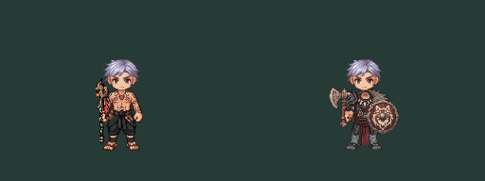

# SOUTH source-bound repairs — revision03

User authorized repair of approved revision02 art after the SOUTH rig audit. This directory contains separate derivatives. Revision02 approved originals and production male/female assets remain untouched.

## Repeatable preflight — 2026-10-12 follow-up

Run `node docs/design/equipment/class-2-first-pair-03/validate-stage.mjs` from repository root. The offline validator re-runs bounded body repairs and actual placement audit with the candidate axe override, verifies unchanged source body/head/axe hashes, checks every reflected axe pixel and paired grip origin, and checks audit-to-candidate hash bindings. It writes `stage-validation.json` with explicit eight-direction/action coverage. The command passed; added paid generations0. This is a narrow implemented preflight, not the full proposed production validator in the outfit specification.

Current coverage is one SOUTH idle candidate per class. Seven views and all outfit action clips are missing; hurt/death clips are unsupported by current V3. No blank layers, mirrored costume sides or existing novice action clips are claimed as completed outfit assets. The next art stage is a source-bound static directional proof; full eight-direction batches and animation follow the documented visual gates. Appearance policy and production integration remain proposals.

The corrected axe preview supersedes the inward-blade image for review. Historical default rig-audit output intentionally still describes current production artwork. This preflight does not mark repaired costume art approved or change game rendering.

## What changed

Achan:121 guarded pixel replacements restore the original skin/contact pixels in rectangles[38,75,47,84] and[78,73,85,81]. Tattoos, black wrap and every pixel outside those rectangles stay byte-identical to approved revision02.

Juggernaut: one paid lower-mask attempt erased the legs; it is retained as `juggernaut-lower-raw.png`, rejected, never used as the delivered body. A second independent paid attempt repaired the arm regions but left old low fists; enlarged inspection caught and removed these duplicates with guarded patches. The final lower costume was reconstructed on the original male leg/boot silhouette using a five-shade dark steel/leather ramp and a shortened approved crimson center strip. No whole-body rescaling, source-base change or grip movement. The final repair changes1482 pixels only within declared arm/lower-costume regions. Upper torso, collar, fur, charms and tattoos outside those regions stay byte-identical.

The lower geometry correction necessarily changes the approved overlong greaves/cape ends; it is a new visual derivative, **not automatically approved**. Keep the original costume approval as the art-direction baseline. No generation of additional directions/animation in this repair step.

## Checks and limits

`verify-repair.mjs` passes: both128×128, lowest opaque row112 matches original, both entire contact rectangles byte-exact to source, no changed pixels outside allowed regions, original base SHA unchanged. See repair-verification.json. These checks establish only the named static invariants, not complete anatomical or animation readiness.

`rig-audit/audit.mjs` re-executes actual equipment placement functions through recorded Phaser calls. Main/off item IDs, scales, origins, rotations and depth unchanged. The shown image is an offline rounded raster preview, not a live Phaser/SSR screenshot. Head is unchanged static reference. Existing novice hand-overlay strips are excluded: source-matching contact rectangles alone do not certify a new complete fingers-over-shaft overlay. No V3 class-outfit resolver exists yet.

Remaining: visual acceptance of repaired lower costume/seams; neck/collar and complete protected-skin masks; candidate-specific hand overlays; live renderer/SSR hairstyle review; technical production-path approval; eight directions and supported animation. No gameplay integration, female edits or public asset replacement.

## Cost and provenance

Paid inpaint jobs: lower `36b31d5b-a174-433c-89f1-3798e7fcc036`, seed2301,10 generations (rejected); hands `0b5ac5f7-e4b9-4934-8e3b-ee6f39d2a057`, seed2302,10 generations (intermediate, duplicate fists corrected). Actual20 spent; balance215→195. No further paid retries. Free PixelLab Workbench edits: Achan `a24977b6-33cc-4f31-9a08-c9ae72f71383`, lower reconstruction `77c7bbb6-36ba-4262-a3bc-1b83df308bfe`, hand merge `66382af8-fc35-4151-89b8-e3e0e94f1a5c`, duplicate cleanup `28072ba6-fc15-482a-a0dc-71711941086b`.

Guarded patch JSONs retain exact expected/replacement RGBA pixels and reasons. Helper scripts compute decisions from owned source images; PixelLab Workbench applies edits. prepare-review.mjs and audit script only compose offline review evidence. Raw provider files and receipts are retained. Offline verification passed; no build/gameplay tests run because runtime/gameplay code was not changed.
