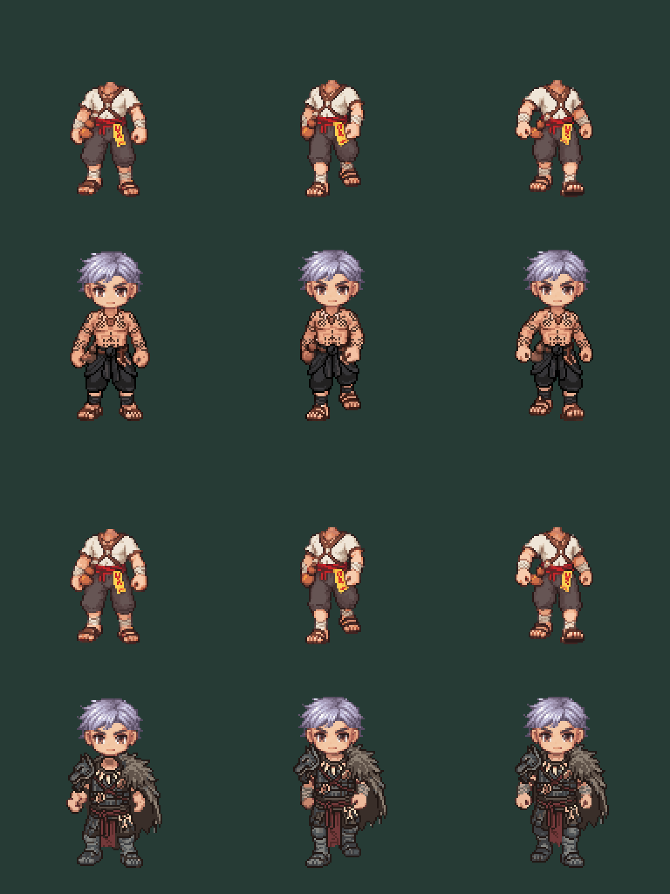

# Paired SOUTH walk transfer feasibility — 2026-10-13

User requests continuing both outfits. Two bounded transfer_outfit jobs each batch3 selected original SOUTH walk frames0,3,7, using source-bound revision03 SOUTH costume reference. Native128, intentionally headless, no new base, no original source replacement or runtime implementation. This tests replacement-frame authoring feasibility only; it does not approve the production architecture or layer/appearance policy.

Rows1/3 are original headless motions. Rows2/4 are Thai/Russian candidates with unchanged source head composed at original moving-neck offsets for diagnostics. They are not the user-fitted Russian idle offsets, and are not accepted moving-neck placements. Columns are source indices0,3,7, **not a complete sequential clip**. No GIF is presented as a finished walk.

## Result and remaining failures

All6 outputs128×128; lowest opaque row matches each original source (ground delta0). Outputs are distinct and the reference idle pose has not replaced all3 source step poses. Thai cloth/tattoos and Russian armor/fur transfer into three different poses. This is a promising art-transfer result, not complete body/anatomy preservation or animation validation.

All contacts are diagnostic. In frame3, the original cached main/off hand anchors already land on transparent source pixels; the output does not cause that pre-existing mismatch. Checks record both source/candidate RGBA explicitly. Hand-color changes, Russian expanded upper fur/cape and moving collar alignment still require authored source/pose fitting before equipment attachments. Do not silently treat stale source anchors as the ground truth or copy static idle head offsets into motion.

## Cost/provenance

Thai job d40341ae-47e4-4d3f-b171-3905b39936b9, seed2601,10 generations. Russian bb9891ff-9fff-49e2-947e-1f1274844c9d, seed2602,10. Actual20; balance171→151; two attempts, no retries. Exact prompts/submission and completion receipts retained in JSON. All raw outputs retained.

Run `node docs/design/equipment/class-2-motion-proof-01/review.mjs` from repository root for real manifest source hashes, source/candidate bounds, neck offsets and5×5 contact diagnostics. No synthetic frame interpolation, complete motion, runtime compatibility or user visual approval claimed. Current remaining action coverage: only these3 selected SOUTH walk candidates per class; other5 SOUTH walk frames, other7 walk facings and all outfit attack/cast frames absent. Female untouched.
