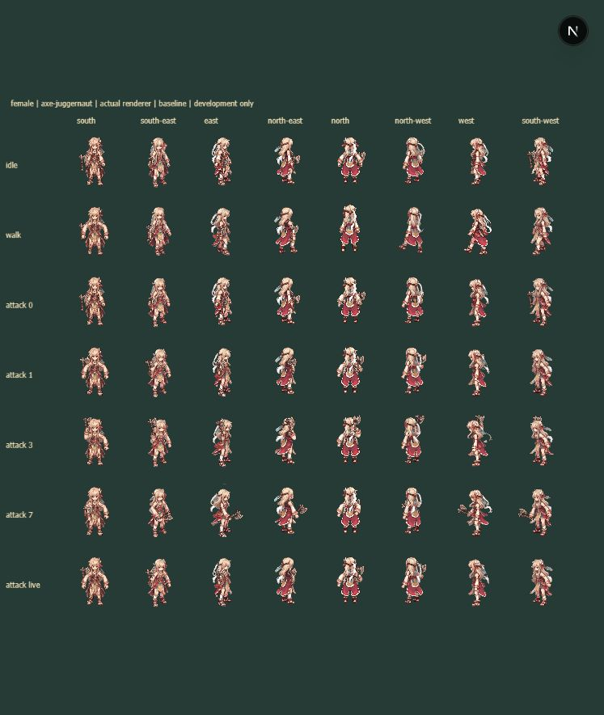
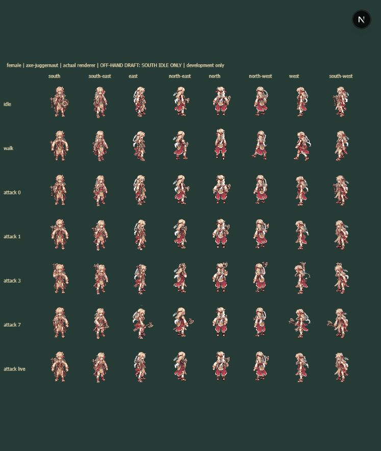

# Female legacy off-hand review — 2026-10-12

QA-F01 remains open. This is a development-only prototype covering four SOUTH idle frames, not a completed female equipment fix or visual approval.

The requested LEFT ARM joints in `docs/design/rig/skeletons.json` drift from visible palms in the packaged artwork. `idle-source-skeleton.png` records that comparison. The candidate therefore uses manually measured SOUTH palm/outline coordinates from the actual owned sprite strip, with source SHA-256, per-frame hashes and opaque pixel checks in `candidate.json`. Opacity checks do not establish correct anatomy or art approval.

Run `node tools/rig/review_female_offhand.mjs` to reproduce the evidence and candidate. This does not rewrite production manifests or character sprites and uses no generation service.

Open `/?carryReview=1&body=female&weapon=axe-juggernaut` for the baseline; add `&femaleOffhand=1` for the candidate. Only development carry review loads the candidate. Unmeasured directions/actions retain the existing rig. No V3 joint fallback is borrowed.

The SOUTH idle cell now displays a shield. Remaining cells intentionally show the existing behavior. Screenshots are from the actual renderer, including its existing wardrobe/art overlaps; they do not certify clipping, animation continuity or the other seven directions.

Validation: renderer tests cover four candidate grips and shield visibility, immutable production frames, male isolation and missing direction/action/frame behavior. Existing 1,568 V3 placements and 512 legacy main-hand frames pass. Workspace typecheck, production build and the complete `test:equipment` suite pass, including ten-branch synchronization, authoritative equip validation and save/restart persistence. Full movement/attack measurements, dual-blade visual review, mobile review and user visual approval remain outstanding.

Changed implementation: `legacy-offhand-review.ts`, `ModularRig.ts` (conditional loader), `CharacterRig.ts` (optional data overlay), `FoundationScene.ts` (female review board), `weapon-carry-test.mjs`, the candidate JSON and reproducible evidence script. Gameplay hitboxes/combat logic are unchanged.
