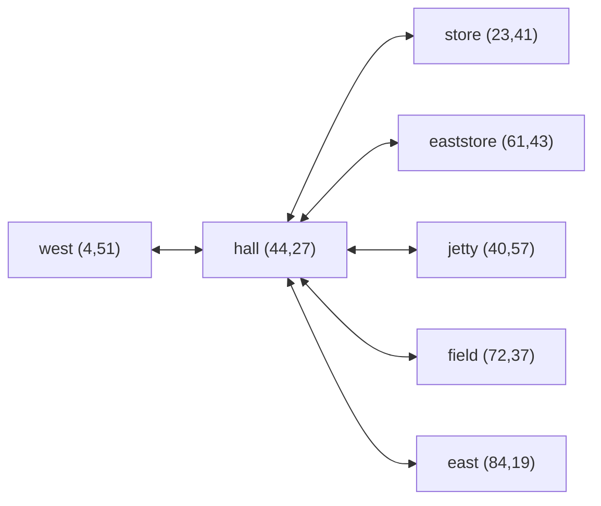

# ท่าเรือนไม้เฝ้าวิญญาณ — spirit-timber-harbor layout brief

## 1. สถานะและขอบเขต
Draft 2026-10-15; three Norway local previews requested by USER. Based on MAP_DESIGN_TEMPLATE.md and SHAMAN_MAP_DESIGN_STANDARD.md. No live portals, multiplayer rooms, NPC services or atlas-node changes. Existing 15 live maps and 33 atlas entries stay intact. Norway rune-seer / ullr-hunter detailed draft outfits exist; this is not character/motion approval. New lore, geography and levels are proposals.

## 2. ประสบการณ์และสเกล
88×76 world units; U=32px, native16px/unit, asset scale2, walk4units/sec. Main lane4.6units, side approaches4units; building fronts8–12units. Overview plus player-camera desktop and mobile portrait/landscape required. Measured route lengths follow in plan/validation, not straight entrance distance.

## 3. ผังภาพรวมและ terrain
North ↑; rectangular continuous world. Sheltered southern inlet under original tall-gabled timber hall. Service buildings face the square, boats are moored decorative props. This third country location/name is provisional, not a new approved atlas node.
Scaled authored polygons and route graph are stored in map.json / plan.json after graybox. Zones: entrance clearings, central travel corridor, landmark forecourt, side encounter fields, riparian no-spawn bands. Exclude all wet cells and base footprints from walking.

## 4. Navigation graph และทางเข้า
west (4,51) → harbor square (35,49) → timber hall (44,27) → east (84,19). All bidirectional. Explicit branch nodes lead to every building front and proposed encounter field. Entrances are local walk-test points, NOT working portals. No bridge crossing needed in this layout; boats/decks decorative-only.

## 5. รายการอาคารและสถานที่จำเป็น
Required stable IDs: great-hall, west-store, east-store, harbor-boat. Each building has separate blocking base, native crop bounds, bottom-center sprite anchor, front approach and court. North-facing roof screen bounds must not cover the south approach. All buildings decorative interiors; reachable fronts only. Failed placement IDs/reasons must be recorded and corrected, never silently pruned.

## 6. น้ำ หน้าผา และพืชพรรณ
Authored curved bays/lake polygons, no whole-map scaling or grid/hash scatter. WaterLayer animation with local fog over sheltered water only; no fog blanket over roads. Explicit pine/birch masses frame courts; authored low heather/rock details along bank. Shared weathered dry edges and bank ecology remain visual-only. Cliff-like isolated rock props are exposed boulders, NOT a claimed continuous mountain/climbable cliff system.

## 7. Asset kit และรอยต่อ
One original Norway atlas proposed: hall/lighthouse/store, pine/birch/beacon, boat/rock/jetty and three hand-painted ground swatches. Tool/receipt/prompt in norway-01. PixelLab checked zero; ComfyUI8188 unavailable; imagegen fallback. No third-party sprites or sacred writing. Nearest-filtered native pixels; weighted deterministic quilt variation within authored masks. Straight/concave/convex road/bank transitions reuse existing tested renderer.

## 8. Layer และ runtime mapping
Terrain/transition: native-terrain → quiltPaint → weatherGroundEdges. Water: shared WaterLayer native semantic mask. Props: authored objects/footprints with y-sort/contact shadow. Mist: shared localized atmosphere. Terrain is flat level0 in this preview; no stair or waterfall claims. Review local actor uses shared stepMovement/isBlocked, no server mutation.

## 9. Gameplay locations
Proposed encounters and service clearings in plan locations; NPC/monster type/levels provisional and displayed separately. Broad fight spaces away from arrival/lanes/water. Live entities and transitions deferred until preview adoption requested.

## 10. การตรวจและหลักฐาน
Required IDs, full support footprint, half-unit reachability and main+side walk roundtrips required. Verify unchanged source hashes, native water/collision correspondence and atlas crop bounds. Build/typecheck, existing-country regressions, desktop/portrait/landscape screenshots and label-off camera inspection required. Status: not run at brief creation; user visual approval pending. No claim of physical-device/multiplayer QA for a local preview.

## Measured layout revision / 2026-10-15

Main route 90.3 world units / 22.6 seconds at speed4. All main/side roundtrips and 7 destinations pass shared movement. Required locations remain explicit; failed placements: none.

Schematic above shows connectivity only; exact scaled geometry/entrances follow in plan.json graph (all edges bidirectional). North ↑.

| Stable object ID | Base anchor | Blocking base w×h | Sprite crop / native width | Front access |
| --- | --- | --- | --- | --- |
| great-hall | 44,21 Z0 | {'w': 11, 'h': 4} | hall / 220px | plan.locations / sideTours |
| west-store | 23,36 Z0 | {'w': 5, 'h': 3} | house / 110px | plan.locations / sideTours |
| east-store | 61,38 Z0 | {'w': 5, 'h': 3} | house / 112px | plan.locations / sideTours |
| harbor-boat | 43,69 Z0 | decorative only | boat / 86px | plan.locations / sideTours |

Shared native water mask uses rounded polygon boundaries; no bridge crossing/elevation transitions claimed. Roof source rectangles are in norway-01/manifest.json; bottom-center anchor and scale2. Entrances/courts are separate local nodes. Live NPC/monster/portal lists intentionally empty. Source generation1; no additional art calls. Visual inspection/evidence in ../norway-three/README.md; user acceptance pending.
